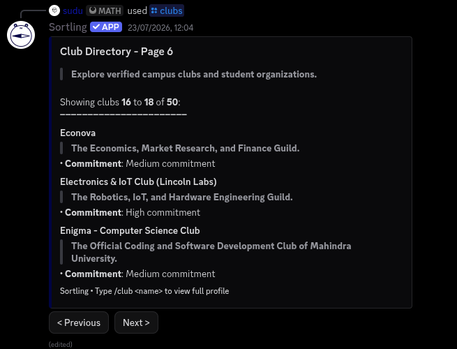

# Sortling

> An intelligent campus sorting engine and centralized club discovery platform.

## Team

**Team name:** No Name

### Members

- Arjun Rajindra — [@ArjunRajindra](https://github.com/ArjunRajindra)
- Sujay Sudhir — [@keepsloading](https://github.com/keepsloading)

---

## Problem

Extracurricular life at universities suffers from severe discovery paralysis and communication breakdown:

1. **Inbox Clutter & Alert Fatigue:** Student inboxes are overwhelmed by endless promotional emails from campus clubs. Because critical course notices get buried under club spam, students develop email fatigue and hesitate to open university mail altogether, missing both vital academic announcements and club recruitments.
2. **Choice Paralysis for Students:** Navigating 50+ clubs across tech, cultural, and sports domains is intimidating—especially for freshers who don't know where their skills, availability, and passions best align.
3. **The Real-World Bottleneck (Lessons from our Discord Prototype):** We deployed a Sortling prototype directly inside the **Mahindra University Discord server**. Students actively used the bot for recommendations, but maintaining the registry manually (updating events, revising club rosters, tracking dates) quickly became exhausting and unsustainable for a small team.

To scale, the platform needed to evolve beyond a bot into a centralized web platform that completely eliminates manual maintenance overhead.

---

## Solution: The Scaled Web Platform

Sortling Web transitions the tested recommendation engine into a zero-maintenance web ecosystem with two distinct operational strategies:

### Two-Sided Platform & The Zero-Burden Strategy

```
                          ┌──────────────────────────────────────────────┐
                          │         Sortling Central Web Engine          │
                          │   (Student Portals + Recommendation Tree)    │
                          └──────────────────────┬───────────────────────┘
                                                 │
                   ┌─────────────────────────────┴─────────────────────────────┐
                   ▼                                                           ▼
         [ Plan A: Direct Buy-In ]                                   [ Plan B: Agentic Fallback ]
         Clubs onboard with dedicated accounts                       Autonomous AI Inbox Agent
         Full control to post, update & track                        Monitors & parses incoming club emails
                   │                                                           │
                   └──────────────────────► ◄──────────────────────────────────┘
                                 Zero Manual Maintenance
```

- **Plan A (Official Club Onboarding):**
  If clubs join the platform, Sortling operates as a two-sided platform with **Student Accounts** and **Club Accounts**. Club executives have total self-service control to publish verified announcements, update deadlines, launch 1-click registrations, and review applicant pipelines.
- **Plan B (Autonomous AI Ingestion Fallback):**
  If clubs are slow to onboard, an **AI Agent monitors and parses incoming club broadcast emails** and campus circulars automatically. The agent extracts event dates, eligibility, and descriptions to feed the database engine autonomously. Students still get full access to the recommendation engine, club profiles, and event hub.
- **Outcome:** Either way, the platform remains 100% self-sustaining with **zero manual data-entry burden**.

---

## The Tested Proof-of-Concept (Discord Prototype)

Before designing the web architecture, we built and battle-tested our core matching algorithms live on the **Mahindra University Discord server**:
- **Adaptive Matching Engine (`/sort`):** An interactive "Sorting Hat" evaluating student responses through an information-gain decision tree to output top-3 club recommendations with personalized fit explanations.
- **Campus Directory (`/clubs`):** Searchable, paginated directory pre-loaded with 50+ verified Mahindra University organizations (including Enigma, Roboverse, Econova, and Lincoln Labs).
- **Event Registry (`/event`):** Live competition listings (e.g., Smart India Hackathon 2026) with prizes, timelines, and registration details.
- **Live Self-Training Engine:** An online gradient reinforcement loop (`TrainingService`) where student corrections via *"Am I wrong?"* dynamically recalibrate club trait vectors in real time.
- **Pre-Built REST API:** The prototype already hosts a Python REST API (`sorts/web/api.py`) exposing endpoints (`/api/university`, `/api/clubs`, `/api/sessions`) ready for the web frontend.

---

## Proof-of-Concept Screenshots (Tested at Mahindra University)

| 1. Verified Club Directory (`/clubs`) | 2. Adaptive Match Results (`/sort`) |
| :---: | :---: |
|  |  |
| *Browsing Mahindra University clubs with pagination* | *Decision-tree matches with tailored "Why you fit" rationales* |

| 3. Engine Overview & Architecture (`/about`) | 4. Live Event Hub & Registration (`/event`) |
| :---: | :---: |
|  |  |
| *Campus discovery engine explanation and command guide* | *SIH 2026 event details, prizes, dates, and registration* |

---

## Technologies used

- **Backend & Core Engine:** Python 3.12, SQLAlchemy 2.0, SQLite / PostgreSQL
- **Prototype Client:** Nextcord (Discord Gateway & UI component views)
- **Matching Algorithm:** Shannon entropy decision tree & 4-tier cosine/dot-product trait vector scoring
- **Online Training:** Decayed gradient adjustment reinforcement loop
- **Data Validation & Parsing:** Pydantic v2, BeautifulSoup4
- **Hosting & Monitoring:** Render cloud web service

---

## How to run (Proof-of-Concept Prototype)

### 1. Setup Environment

```bash
python3 -m venv .venv
source .venv/bin/activate
pip install -r requirements.txt
```

### 2. Configure Settings

```bash
cp .env.template .env
# Set DISCORD_TOKEN in .env (or run in CLI mode without Discord token)
```

### 3. Run the Interactive CLI Demo

Test the decision-tree sorting engine locally in your terminal without a Discord bot token:
```bash
python3 -m sorts.cli seed
python3 -m sorts.cli interactive --university-slug mahindra
```

### 4. Run the Prototype Bot & REST API Server

```bash
python3 main.py
```

---

## Notes & Future Roadmap

- **From Bot to Web App:** Porting the vector engine into a full-stack web application with dedicated student portals and club officer dashboards.
- **Autonomous Inbox Agent Deployment:** Finalizing the automated email parsing agent for universities relying on legacy mail blasts.
- **Unified Student Application Tracker:** Allowing students to track all their club applications across departments in one clean dashboard.
